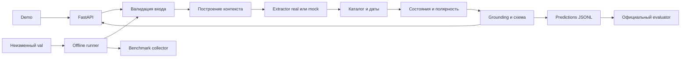

# Архитектура и интеграционные контракты

## Выбор подхода

| Подход | Сильные стороны | Цена и риск | Решение |
|---|---|---|---|
| Qwen → готовый JSON | Прямое SFT по gold, контекст подтверждений | Ошибки JSON/дат, autoregressive latency | Первая рабочая версия |
| Encoder/span+relations | Параллельное извлечение, потенциально дешевле | Нужно выравнивать шумные spans, отдельные головы времени/отношений, больше разработки | Исследовательский резерв, не аварийная замена в последний день |
| Qwen+детерминированные проверки | Быстрое SFT, исправляемые даты/grounding, ясные интерфейсы | Правила могут навредить, нужны абляции | Основная архитектура |

Резерв поставки — та же компактная Qwen с минимальной безопасной постобработкой; encoder использовать только если audit рано подтвердит подходящие веса и бюджет. Смена архитектуры позднее 14 ноября 18:00 запрещена внутренним freeze.



Gold не попадает в API, prompt или normalizers. Offline runner отделяет features от targets до вызова общего pipeline. Истории используются только в пределах официально доступных входов; no global state между независимыми звонками. Иначе порядок val изменит результаты.

## Модули

Обозначения владельцев: DE — участник 1; ML — участник 2; FS — участник 3. Все функции получают immutable original turns. Ошибка любого этапа имеет module/error_code, не скрывается.

| Модуль / Python interface | Владелец | Вход → выход | Зависимости | Ошибки / проверка / DoD |
|---|---|---|---|---|
| `validate_input(raw)->CallInput` | FS | JSON → CallInput | Pydantic | 422 на дубликат idx/неверную дату; контрактные fixtures проходят |
| `prepare(call,tokenizer)->ModelInput` | ML | call → текст/токены+map | tokenizer, prompt version | context overflow; original idx сохранены, round-trip map проверен |
| `Extractor.extract(call)->CandidateBatch` | ML | вход → кандидаты | веса/engine либо mock | load/OOM/parse; mock и real один контракт |
| `normalize_catalog(candidates,catalog)->Candidates` | DE | имена/значения → канонические+trace | catalog hash | ambiguous alias: без склейки; случаи близких тарифов проходят |
| `normalize_time(candidates,call)->Candidates` | DE | выражение/дата → ISO+trace | started_at | неоднозначный weekday/month; набор даты/месяцы/границы года проходит |
| `reconcile_state(candidates)->Candidates` | DE | события → интервалы | object resolution,time | конфликт/одновременность: warning; два объекта не смешиваются |
| `validate_polarity(candidates,call)->Candidates` | DE | кандидаты+контекст → проверенные | исходные роли/реплики | scope uncertain: не инвертировать; «не работает» и «не использую» различены |
| `ground(candidates,call)->Facts` | DE | source candidates → idx/span/quote | original turns | нет источника: кандидат отклонён с trace; exact substring либо null |
| `validate_output(facts,call)->Prediction` | FS | facts → официальный формат | shared schemas | неверный interval/idx: ошибка; все fixtures валидны |
| `serve(request)->ExtractResponse` | FS | HTTP → envelope | pipeline, worker | очередь/timeout/load; mock smoke и real E2E проходят |
| `evaluate_run(pred_path,gold_path)->Metrics` | ML | JSONL → официальный JSON | неизменный evaluator | IDs/duplicates проверяются до скрипта; baseline воспроизведён |
| `benchmark(run,hardware)->ResourceReport` | FS | config+одинаковый набор → JSON/CSV | collector, sync | hardware missing → null/reason; raw times и peak сохранены |

## Candidate v1 и этапность

Для первого SFT target — минимальные официальные факты с датами, speaker и source.turn_idx. Это позволяет работать без ручной разметки новых полей. `CandidateFact` оборачивает такой факт и добавляет внутренние `object_key`, `evidence_turns`, `temporal_expression: str|null`, `confirmation: confirmed|rejected|unknown`, `provenance` и `warnings`. Эти поля не требуют генерации моделью на первом этапе: адаптер может заполнить null, извлечь исходную фразу правилами.

Даты, выданные моделью, остаются fallback. Правила заменяют их только при однозначном выражении в исходном контексте; каждое изменение логируется до/после. Перевод target в формат с date-expression — отдельная P1-абляция после проверки выравнивания; не обучать сразу на придуманных промежуточных labels. `confidence` не выдумывать из вероятности произвольного токена.

ModelInput хранит call_id, started_at, original idx+speaker+text; никаких facts, confirmed из gold, target valid_from. Опциональная краткая онтология; весь каталог в каждый prompt не вставлять без замера токенов. Extractor возвращает кандидаты и diagnostic status, не произвольную JSON-строку для остальных модулей.

## Длинные звонки

Сначала токенизировать все данные выбранным tokenizer. Если контекст не помещается: окна только по границам turns с перекрытием 2–4 реплики, в каждом started_at и исходные idx; подтверждения на границах сохранять. Один звонок остаётся единицей split, benchmark и evaluation. Dedup по объекту/атрибуту/значению/полярности/дате/источнику; не схлопывать разные исторические состояния. Стоимость всех окон относится к исходному звонку. Настройки окон одинаковы A/B/C.

## Репозиторий и версии (проектная структура)

```text
src/contracts/                 # FS, общие Pydantic схемы
src/data/, src/normalizers/     # DE
src/ml/, configs/train/        # ML
src/pipeline/, src/api/        # FS, сборка модулей
frontend/, docker/, .github/   # FS
tests/{contracts,data,ml,e2e}/
data/raw/                      # readonly, manifest, не Git
artifacts/models/<model_id>/   # внешние веса, SHA256, не Git
experiments/<run_id>/          # config/manifest/predictions/metrics/resources
reports/                      # CSV, графики, error review
docs/                         # текущий план
```

Все пути выше — план, кроме уже созданного docs. Ветки `codex/data-*`, `codex/ml-*`, `codex/api-*`; маленький PR, один reviewer по затронутому контракту, не ждать общего завершения направления. Общие schemas меняет FS после ревью DE/ML; breaking change → v2, не молчаливая замена. git main всегда mock-runnable. Данные и веса в отдельном хранилище/локальном volume с manifest; токены доступа не в Git.

CI: lint/type+быстрые contract/unit/mock API тесты на PR; offline eval небольшого публичного fixture; Docker build/smoke перед integration checkpoint. GPU full-val и performance — отдельные фиксированные manual jobs, CI shared runner не подходит для сравнения ресурсов. Версии зависимостей и base image digest закрепить после первого рабочего окружения. CPU/GPU profiles отдельные; Docker на macOS не даёт CUDA, GPU отчёт требует реального GPU-хоста.
